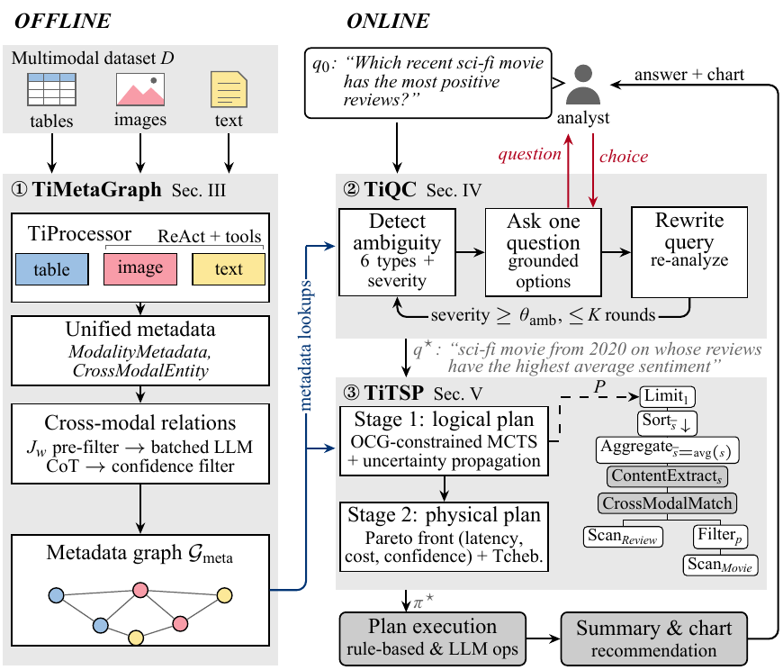

# TiMMInsight

TiMMInsight is an automated, ambiguity-aware system for multimodal exploratory
data analysis with large language models. It answers natural-language questions
over datasets of relational tables, text, and images.

## Architecture



- **TiMetaGraph** (offline) builds a cross-modal metadata graph of the dataset:
  LLM-driven processors extract per-modality metadata with specialized tools
  under ReAct, entities are resolved across modalities, and relationships among
  them are discovered.
- **TiQC** resolves query ambiguity before planning through a multi-round
  clarification dialogue grounded in the metadata graph.
- **TiTSP** compiles the clarified query into a plan in two stages: an
  OCG-constrained MCTS over logical plans with bottom-up uncertainty
  propagation, then Pareto-based selection of physical implementations.
- The plan is executed, and the result is summarized with a recommended chart.

## Environment

Python 3.12. The five baselines (CAESURA, LOTUS, ThalamusDB, Palimpzest,
Nirvana) are installed at the versions used in the paper, each in its own
virtual environment.

```bash
python3.12 -m venv .venv && source .venv/bin/activate
pip install -r requirements.txt
python -m spacy download en_core_web_sm
bash scripts/setup_baselines.sh
```

Set `DASHSCOPE_API_KEY` for the LLM backbones and the vision model, and
`OPENAI_API_KEY` for the GPT-4.1 judge.

Backbones are selected with `--provider` and `--model`; TiMMInsight and the
baselines call the backbone through the same OpenAI-compatible endpoint, with
temperature 0, top_p 1 and thinking mode off:

| Backbone | Flags | Key |
|---|---|---|
| Kimi-K2.6, Qwen3.6-Plus, DeepSeek-V4-Flash, GLM-5.2 | `--provider dashscope` (default) | `DASHSCOPE_API_KEY` |
| GPT-5.5 | `--provider openai --model gpt-5.5-2026-04-23` | `OPENAI_API_KEY` |
| Claude-Opus-4.8 | `--provider bedrock --model anthropic.claude-opus-4-8` | AWS credentials, `AWS_REGION` |
| any other endpoint | `--provider custom --base-url <url> [--api-key-env <VAR>]` | `LLM_API_KEY` |

Claude-Opus-4.8 samples with fixed settings: its API rejects `temperature` and
`top_p`, so these fields are not sent for it.
The baselines speak the OpenAI protocol; for the Bedrock backbone the benchmark
serves them through a local OpenAI-compatible proxy over the same Bedrock
provider (`src/baselines/openai_proxy.py`).

## Data

- **Nirvana-Bench**: `ln -s "$PWD/.baselines/src/nirvana" data/nirvana_repo/nirvana-main`
- **SemBench** (Movie, E-Commerce, MMQA): `python -m scripts.build_benchmarks --stages data` stages them with SemBench's generators (set `ECOMM_SOURCE` and `MMQA_SOURCE` to the downloaded source data).
- **Agriculture** or any other dataset: a directory of CSV/Parquet tables, referenced as `dir:<path>`.

`benchmarks/nirvana_bench.jsonl` and `benchmarks/sembench.jsonl` hold the 426 ambiguity variants of the 71 base queries (`benchmarks/base_queries.jsonl`); `python -m scripts.build_benchmarks` rebuilds them.

## Running the experiments

```bash
# End-to-end accuracy, latency, and tokens of TiMMInsight, its ablations, and the baselines
python src/experiments/benchmark.py benchmarks/<benchmark>.jsonl --model <backbone> \
    --vision-model qwen3-vl-plus --runs 5 --out runs/results.jsonl

# Baselines given TiMMInsight's clarified queries
python src/experiments/benchmark.py benchmarks/<benchmark>.jsonl --model <backbone> \
    --baseline-input clarified --out runs/clarified.jsonl

# Clarification-round budget K (0 disables TiQC)
python src/experiments/benchmark.py benchmarks/<benchmark>.jsonl --model <backbone> \
    --methods timminsight --rounds <K> --out runs/rounds_<K>.jsonl

# Calibration (one run per backbone), then the macro-average over backbones
python src/experiments/benchmark.py benchmarks/<benchmark>.jsonl --model <backbone> \
    --calibration --out runs/<backbone>.jsonl
python -m src.experiments.calibration_table runs/*.calibration.json

# Human audit of the LLM judge
python -m src.experiments.judge_audit sample runs/results.jsonl --n 300 --out audit/
python -m src.experiments.judge_audit score audit/ audit/annotator_*.csv
```

## Demo

A local web workspace over the real system: open a benchmark dataset or import your own (CSV/Parquet/XLSX tables, images, text files, or a zip), build its metadata graph, and ask questions; TiQC's clarification, TiTSP's plans, and the execution trace are shown step by step.

```bash
python -m demo                 # http://127.0.0.1:8765/  (--port, --data-root)
```

Questions use DashScope: set `DASHSCOPE_API_KEY` or paste a key in the page (kept in memory only). Imported data and their metadata graphs stay under `--data-root` (default `runs/demo`).
